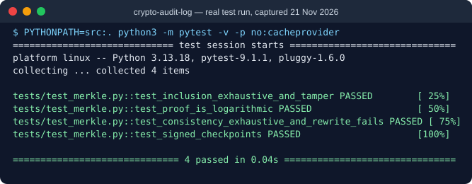

# Verifiable audit log (Merkle tree + Ed25519) — manual

*One page, eight blocks. Every figure here comes from this repository's own tests and README.*

## 1. Claim
Any change to a past entry is detectable. Tests verify inclusion for every leaf up to n=24, consistency for every (m, n) pair, and rejection of forged checkpoints.

## 2. What it is
An append-only log where you can prove an entry is present and that history was never rewritten, using the Merkle construction from Certificate Transparency (RFC 6962) and signed checkpoints.

## 3. Demo
Terminal demo: `python -m auditlog.cli` (append, checkpoint, prove, then tamper and watch it fail). Capture to record.


*Real output from this repository's own tests, captured 21 Nov 2026.*

## 4. Run it yourself
**Prerequisites:** Python 3.

```bash
pip install -e ".[dev]"
PYTHONPATH=src pytest -q
python -m auditlog.cli
```

## 5. What you will see
The exhaustive suites pass. The CLI demo shows a valid proof, then a failure after tampering.

## 6. 30-second talking point
> "Our records were never altered" is an assertion. This makes it a proof a regulator or auditor can check without replaying the whole log.

## 7. Scope and limits
- Integrity, not confidentiality. It proves a record is unaltered, not that it is secret.
- No timestamping authority or gossip/witnessing. Checkpoint custody is the operator's trust root.

## 8. Links
[Repository](https://github.com/fhionnghaile/crypto-audit-log) · [Write-up](https://padraigfhionnghaile.com/work/crypto-audit-log/) · [README](README.md)
